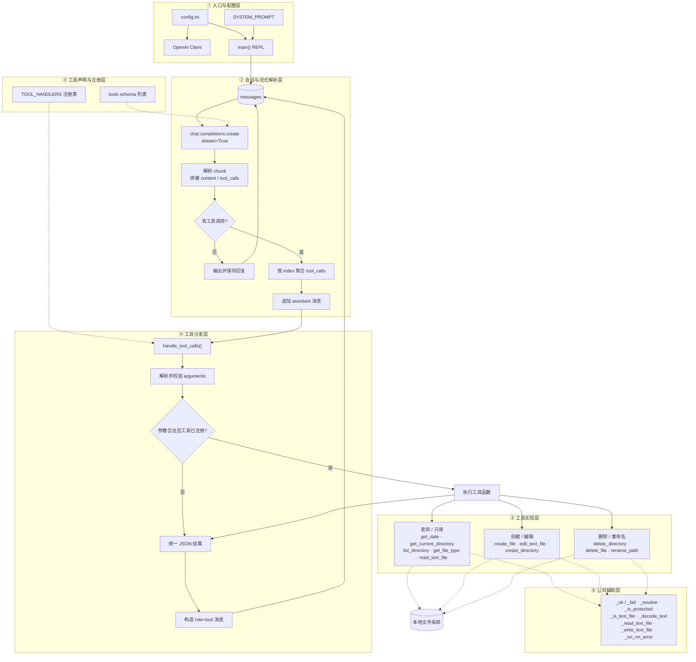

# 本地文件操作 Agent（file_agent.py）

一个基于 OpenAI Function Calling 的命令行 Agent。它在 `chat.py` 的基础上扩展了 10 个文件 / 目录工具，可以理解自然语言指令，直接查询和操作本机文件系统。

- 入口文件：`file_agent.py`
- 架构图：[`architecture.mmd`](./architecture.mmd)
- 依赖：`openai>=1.0.0`

## 目录内容

| 文件 | 说明 |
| --- | --- |
| `file_agent.py` | 文件操作 Agent 主程序，本 README 的说明对象 |
| `architecture.mmd` | 基于 `file_agent.py` 绘制的 Mermaid 代码架构图 |
| `chat.py` | 最基础的流式对话脚本，仅含 `getDate` 工具 |
| `leap_year.py` | 闰年判断示例，仅含 `isLeapYear` 工具 |
| `config.ini` | LLM 接口配置 |
| `requirements.txt` | Python 依赖 |

## 功能特性

- **多轮工具调用**：模型返回工具调用后，程序执行工具并把结果回填给模型，直到模型给出最终回答。
- **流式输出**：回答按 chunk 逐字打印；工具调用参数也按流式片段聚合。
- **11 个工具**：1 个时间查询工具 + 10 个文件 / 目录操作工具。
- **统一 JSON 协议**：所有工具返回 `success` / `error` 结构，模型可以据此判断成败。
- **异常隔离**：单个工具的异常会被捕获并转成错误 JSON，不会中断整个对话。
- **基础安全保护**：删除、重命名等破坏性操作会拦截磁盘根目录、用户主目录、当前工作目录及其上级目录。

## 环境要求

- Python 3.10+（代码使用了 `str | None` 等 PEP 604 类型标注）
- 一个兼容 OpenAI SDK 的接口地址、模型名和 API Key
- `getDate` 工具依赖 Windows 的 `date /t` 与 `time /t` 命令

## 安装

```bash
cd agent/practice02
pip install -r requirements.txt
```

## 配置

`file_agent.py` 读取**脚本所在目录**下的 `config.ini`（`Path(__file__).with_name("config.ini")`），因此可以在任意工作目录启动脚本。

```ini
[llm]
base_url = https://api.deepseek.com
model_name = deepseek-chat
api_key = sk-your-key-here
```

| 配置项 | 说明 |
| --- | --- |
| `base_url` | OpenAI 兼容接口地址 |
| `model_name` | 模型名称，如 `deepseek-chat` |
| `api_key` | 访问密钥，请勿提交到公开仓库 |

## 运行

```bash
python file_agent.py
```

启动后会打印当前工作目录：

```
本地文件操作 Agent 已启动，工作目录: D:\weillm\agent\practice02
按 Ctrl+C 退出
请输入提示词:
```

输入需求后回车即可。按 `Ctrl+C`（或输入流结束 `Ctrl+Z` + 回车）退出。

> 相对路径以**启动脚本时的工作目录**为基准，而不是脚本所在目录；`get_current_directory` 返回的也是启动目录。

## 使用示例

```text
请输入提示词: 列出当前目录下的所有文件
请输入提示词: 读取 README.md 的内容
请输入提示词: 在 D:\weillm\test 下创建 notes.md，内容写“今日待办”
请输入提示词: 把 notes.md 里的“今日待办”替换成“今日完成”
请输入提示词: 查看 D:\weillm\test\data.bin 是什么类型的文件
请输入提示词: 把 notes.md 重命名为 todo.md
```

多步任务通常需要模型连续调用多个工具，例如“先看目录，再读文件，最后改内容”，程序会自动完成“调用 → 回填 → 再调用”的循环。

## 工具一览

| 工具名 | 实现函数 | 主要参数 | 说明 |
| --- | --- | --- | --- |
| `getDate` | `get_date()` | 无 | 调用系统 `date` / `time` 命令获取当前日期时间 |
| `get_current_directory` | `get_current_directory()` | 无 | 返回当前工作目录绝对路径 |
| `list_directory` | `list_directory()` | `directory="."` | 列出目录内容，含类型、大小、修改时间、扩展名、MIME |
| `get_file_type` | `get_file_type()` | `path` | 返回扩展名、MIME、是否纯文本、大小 |
| `read_text_file` | `read_text_file()` | `path` | 读取纯文本，单次最多返回 20000 字符 |
| `create_file` | `create_file()` | `directory`、`filename`、`content=""`、`overwrite=False` | 创建文件，目录不存在时自动逐级创建 |
| `edit_text_file` | `edit_text_file()` | `path`、`mode="replace"`、`content`、`old_string`、`new_string`、`replace_all=False` | 覆盖 / 追加 / 替换文本 |
| `create_directory` | `create_directory()` | `path` | 创建目录，父目录自动创建 |
| `delete_directory` | `delete_directory()` | `path` | 递归删除目录（含非空目录），不可恢复 |
| `delete_file` | `delete_file()` | `path` | 删除单个文件，不可恢复 |
| `rename_path` | `rename_path()` | `source`、`destination`、`overwrite=False` | 重命名或移动文件 / 目录 |

### `edit_text_file` 的三种模式

| `mode` | 行为 |
| --- | --- |
| `replace`（默认） | 把 `old_string` 替换为 `new_string`；默认只替换第一处，`replace_all=true` 时替换全部 |
| `append` | 把 `content` 追加到文件末尾 |
| `overwrite` | 用 `content` 覆盖整个文件 |

`replace` 模式下 `old_string` 不能为空；找不到匹配内容时返回错误。所有写入统一使用 UTF-8 编码和 `\n` 换行。

### `rename_path` 的路径规则

- 只给新名字（如 `todo.md`）时，在原路径所在目录下重命名。
- 给绝对路径或带目录的相对路径时，按新路径移动。
- 禁止把目录移动到它自己的子目录中。
- 目标已存在时默认拒绝；`overwrite=true` 只能覆盖文件，不能覆盖同名目录。

## 架构

完整 Mermaid 源码见 [`architecture.mmd`](./architecture.mmd)。



### 一次请求的执行流程

1. `main()` 读取用户输入，追加到 `messages`。
2. 以 `stream=True` 和 `tools=tools` 调用模型。
3. 遍历流式 chunk：`delta.content` 直接打印，`delta.tool_calls` 按 `tc.index` 聚合到 `pending_tool_calls`。
4. 若本轮没有工具调用，保存 assistant 回复并等待下一次输入。
5. 若有工具调用，先把带 `tool_calls` 的 assistant 消息写入 `messages`。
6. `handle_tool_calls()` 解析参数、查 `TOOL_HANDLERS`、执行具体函数，生成 `role=tool` 消息。
7. 工具结果回填后回到第 2 步再次请求模型，直到模型不再调用工具。

关键设计：`tools` 是给模型看的 JSON Schema，`TOOL_HANDLERS` 是本地“工具名 → 函数”的注册表；两者通过工具名一一对应，新增工具时需要同时修改这两处。

## 工具返回协议

成功：

```json
{
  "success": true,
  "path": "D:\\weillm\\test\\notes.md",
  "size": 42
}
```

失败：

```json
{
  "success": false,
  "error": "文件不存在",
  "path": "D:\\weillm\\test\\missing.md"
}
```

`SYSTEM_PROMPT` 要求模型根据 `success` 和 `error` 判断结果，失败时向用户说明原因，不得假装成功。

## 安全保护

| 保护措施 | 说明 |
| --- | --- |
| 高危路径拦截 | `_is_protected` 拒绝删除 / 重命名磁盘根目录、`BASE_DIR`、用户主目录以及 `BASE_DIR` 的上级目录 |
| 默认不覆盖 | `create_file`、`rename_path` 的 `overwrite` 默认为 `false` |
| 类型校验 | 删除文件不会误删目录，删除目录不会误删文件 |
| 纯文本限制 | `read_text_file` / `edit_text_file` 只处理判定为文本的文件 |
| 二进制检测 | 读取时检查前 8192 字节是否含 `\x00` |
| 只读文件兼容 | Windows 下删除失败时先移除只读属性再重试 |
| 读取上限 | `MAX_READ_CHARS = 20000`，超出部分截断并返回 `truncated: true` |

> 这些保护只针对明显的误操作，**不是沙箱**。Agent 仍可访问当前用户有权访问的任意路径，执行前请自行确认提示词和模型行为。

## 文本文件判定规则

`_is_text_file()` 按以下顺序判断：

1. 扩展名命中 `TEXT_EXTENSIONS` 白名单（`.py`、`.md`、`.json`、`.yaml`、`.csv`、`.sql` 等）→ 文本。
2. MIME 类型以 `text/` 开头或属于 `TEXT_MIME_TYPES` → 文本。
3. MIME 已知但不在上述范围（图片、压缩包、可执行文件等）→ 二进制。
4. 类型未知时读取前 8192 字节，依次尝试 `utf-8-sig`、`utf-8`、`gb18030` 解码；含空字节或全部解码失败 → 二进制。

## 已知限制

- `getDate` 使用 Windows 的 `date /t & time /t`，在 Linux / macOS 上不可用。
- 没有命令白名单或路径白名单，不能作为多用户或生产环境的文件服务。
- 读取最多返回 20000 字符，无法一次读取超大文件。
- `replace` 模式是字面量替换，不支持正则。
- 会话历史只保存在内存中，退出即丢失。
- `config.ini` 中的密钥为明文，建议加入 `.gitignore`。

## 常见问题

**`ModuleNotFoundError: No module named 'openai'`**
执行 `pip install -r requirements.txt`。

**`KeyError: 'llm'`**
`config.ini` 不存在、路径不对或缺少 `[llm]` 段。配置文件需与 `file_agent.py` 放在同一目录。

**`Error code: 401`**
`api_key` 无效或已过期。

**`Error code: 402 Insufficient Balance`**
账户余额不足。

**工具一直返回“仅支持读取纯文本文件”**
目标文件被判定为二进制（如 `.docx`、`.pdf`、`.xlsx`），本工具不支持解析这类格式。

**删除目录时报“拒绝操作当前工作目录本身”**
这是预期的安全保护。请进入目标目录的上级目录启动脚本，或操作具体的子目录。

**模型反复调用同一个失败的工具**
检查返回的错误 JSON，确认路径是否存在、参数是否为合法 JSON，必要时在提示词中给出完整绝对路径。
