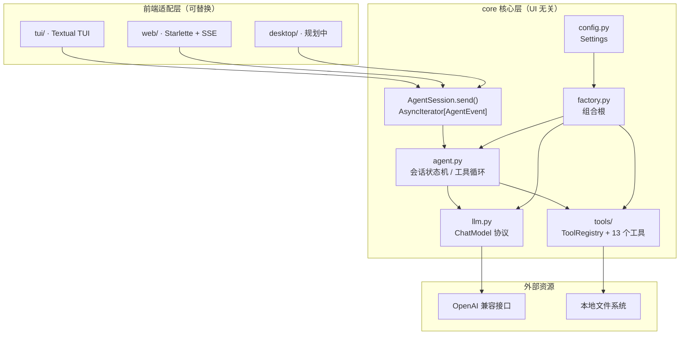

# xagent

基于 `D:\weiLLM\agent\practice02\file_agent.py` 改造的本地文件操作 Agent。

核心目标是把**业务逻辑**与**界面展示**彻底分离：

- `core/`：Agent 编排、LLM 访问、工具注册与执行、配置。完全不依赖任何 UI 框架，也不直接 `print`。
- `tui/`：Textual 终端界面，只消费 `core` 暴露的异步事件流。
- `web/`：Starlette Web 服务 + 原生浏览器前端，通过 SSE 消费同一套事件流。
- 未来新增 `desktop/` 时，复用同一个 `core`，不需要修改 Agent 逻辑。

## 目录结构

```text
xagent/
├── core/                       # 核心层（UI 无关）
│   ├── __init__.py             # 公共 API 出口
│   ├── agent.py                # AgentSession：对话状态机 + 事件流
│   ├── config.py               # Settings / config.ini / 环境变量
│   ├── events.py               # UI 无关的事件模型
│   ├── factory.py              # 组合根：装配模型、工具、会话
│   ├── llm.py                  # ChatModel 协议 + AsyncOpenAI 实现
│   ├── models.py               # 工具调用 / 工具结果等领域对象
│   ├── prompts.py              # 系统提示词
│   └── tools/
│       ├── base.py             # Tool、ToolContext、ToolRegistry
│       ├── curl.py             # 本地 curl 调用与网络异常处理
│       ├── filesystem.py       # 10 个文件 / 目录工具
│       ├── helpers.py          # 路径、文本、JSON、安全保护
│       ├── search.py           # 网络搜索工具 searchweb
│       ├── system.py           # 时间查询工具
│       └── web.py              # 网页正文抓取工具 fet
├── tui/                        # Textual 表示层
│   ├── __main__.py             # python -m tui
│   ├── app.py                  # XAgentApp：事件 → 界面
│   ├── commands.py             # 斜杠命令解析
│   ├── styles.tcss             # Textual CSS
│   └── widgets/
│       ├── chat.py             # 消息容器与自动滚动
│       ├── messages.py         # 用户 / 助手 / 工具 / 错误消息
│       ├── prompt.py           # 带提示符与历史记录的输入栏
│       ├── status.py           # 状态栏与 busy spinner
│       └── welcome.py          # 启动欢迎面板
├── web/                        # Starlette + 原生前端
│   ├── __main__.py             # python -m web / xagent-web
│   ├── app.py                  # 路由、SSE、会话 API
│   ├── sessions.py             # WebSession / SessionStore
│   └── static/
│       ├── index.html          # 单页应用结构
│       ├── styles.css          # 响应式 / 明暗主题
│       ├── app.js              # SSE、Markdown、工具卡片、交互
│       └── favicon.svg
├── tests/                      # 无网络回归测试
├── main.py                     # 统一启动入口
├── config.ini                  # 本地配置（已 gitignore）
├── config.ini.example          # 配置模板
├── pyproject.toml
└── requirements.txt
```

## 分层与依赖规则

```text
tui / web（及未来的 desktop）
        │  只依赖 core 公共 API 和事件
        ▼
core/agent.py  ──►  core/llm.py  ──►  OpenAI 兼容接口
        │
        └────────►  core/tools  ──►  本地文件系统

core/factory.py 负责上述依赖的装配；core/config.py 提供配置。
```

必须遵守的约束：

1. `core` 不得导入 `tui`、`web`、`textual`、`starlette` 或任何界面 / Web 框架。
2. `tui` 和 `web` 不直接访问 OpenAI 客户端、工具实现或文件系统，只通过 `AgentSession` 交互。
3. `core` 通过事件流反馈进度，不直接输出到控制台，方便不同前端复用。
4. 工具统一返回 JSON 字符串；异常在 `ToolRegistry` 内被转换为失败结果。
5. 新增前端只依赖 `core` 的公共 API；新增工具只修改 `core/tools`。

## 架构图



### 一次请求的事件流

```text
AgentSession.send(prompt)
  ├─ RunStarted
  ├─ TextDelta*                       # 模型流式文本
  ├─ ToolCallStarted                  # 即将执行工具
  ├─ ToolCallFinished                 # 工具执行结果
  ├─ TextDelta*                       # 模型根据结果继续回答
  └─ RunFinished / RunFailed
```

工具调用会按模型返回顺序执行，结果回填到对话历史后再次请求模型，直到模型不再调用工具。`max_tool_rounds` 防止模型陷入无限工具循环。

## 环境要求

- Python 3.10+
- `openai>=1.30,<4`
- `textual>=0.80,<9`
- `starlette>=0.37,<2`、`uvicorn>=0.30,<1`（Web UI）
- `trafilatura>=2.0,<3`、`lxml>=6.0`、`lxml_html_clean>=0.4`（`fet` 提取正文并转 Markdown）
- 本地 `curl`（Windows 10/11 自带 `C:\Windows\System32\curl.exe`），`fet` 和 `searchweb` 通过 `subprocess` 调用它访问网络
- 百度千帆 API Key（`searchweb` 调用百度搜索 API，未配置时搜索工具会返回明确提示）
- 现代浏览器（支持 `fetch` 流式读取、CSS 变量和 `100dvh`）
- `get_date` 在 Windows 上调用系统 `date` / `time` 命令，其他平台回退到 Python 时间

## 安装

```bash
cd agent/xagent
pip install -r requirements.txt
```

也可以安装为命令：

```bash
pip install -e .
xagent        # TUI
xagent-web    # Web UI
```

## 配置

复制模板并填写密钥：

```bash
copy config.ini.example config.ini
```

```ini
[llm]
base_url = https://api.deepseek.com
model_name = deepseek-chat
api_key = sk-your-key-here

[agent]
max_read_chars = 20000
max_tool_rounds = 16

[search]
baidu_qianfan_api_key = your-qianfan-api-key
endpoint = https://qianfan.baidubce.com/v2/ai_search/web_search
top_k = 10
```

| 配置项 | 说明 |
| --- | --- |
| `base_url` | OpenAI 兼容接口地址 |
| `model_name` | 模型名称 |
| `api_key` | 访问密钥 |
| `max_read_chars` | 单次读取文件返回给模型的最大字符数 |
| `max_tool_rounds` | 单轮用户请求允许的最大工具调用轮数 |
| `search.baidu_qianfan_api_key` | 百度千帆 API Key，`searchweb` 使用；留空时搜索工具返回配置提示（兼容旧配置名 `search.api_key`） |
| `search.endpoint` | 千帆百度搜索接口地址，通常无需修改 |
| `search.top_k` | 默认返回的网页结果数量，范围 1~50 |

配置查找顺序：`--config` 参数 > `XAGENT_CONFIG` 环境变量 > 项目根目录 `config.ini` > 启动目录 `config.ini`。

单项配置也可用环境变量覆盖，适合 CI / 部署场景：

| 环境变量 | 覆盖项 |
| --- | --- |
| `XAGENT_BASE_URL` | `base_url` |
| `XAGENT_MODEL` | `model_name` |
| `XAGENT_API_KEY` | `api_key` |
| `XAGENT_QIANFAN_API_KEY` / `XAGENT_SEARCH_API_KEY` | `search.baidu_qianfan_api_key` |
| `XAGENT_SEARCH_ENDPOINT` | `search.endpoint` |
| `XAGENT_CONFIG` | 配置文件路径 |

`config.ini` 已加入 `.gitignore`，请勿提交真实密钥。

## 运行

TUI（默认）：

```bash
python main.py
# 或
python -m tui
# 指定配置文件 / 工作目录
python main.py --config .\config.ini --directory D:\weillm\test
```

Web UI：

```bash
python main.py --ui web
# 或
python -m web
# 指定端口 / 不自动打开浏览器
python -m web --port 8001 --no-open
```

Web 默认监听 `127.0.0.1:8000`，启动后会自动打开浏览器。相对路径以**启动时的工作目录**（或 `--directory` 指定目录）为基准。`get_current_directory` 返回同一个基准目录。

## TUI 使用

启动后进入聊天界面：

- 顶部标题栏显示应用名和当前时间。
- 欢迎面板展示工作目录、模型和快捷提示。
- 消息以卡片呈现，用户 / 助手 / 系统 / 错误各有独立配色和时间戳。
- 工具调用显示为卡片，完整参数与结果默认折叠，点击 `▸ 参数与结果` 展开。
- 状态栏在 Agent 工作时显示动画 spinner，并持续显示模型和工作目录。
- 底部输入栏带 `❯` 提示符，聚焦时边框高亮。

```text
❯ 输入指令，Enter 发送 · /help 查看命令
```

示例指令：

```text
列出当前目录下的所有文件
读取 README.md 的内容
在 D:\weillm\test 下创建 notes.md，内容写“今日待办”
把 notes.md 里的“今日待办”替换成“今日完成”
把 notes.md 重命名为 todo.md
打开 https://example.com 并总结主要内容
搜索 Python 最新版本，并打开官网确认
搜索“人工智能 最新进展”，列出三条结果
```

### 快捷键

| 按键 | 功能 |
| --- | --- |
| `Enter` | 发送消息 |
| `↑` / `↓` | 浏览输入历史 |
| `Esc` | 取消当前请求 |
| `Ctrl+N` | 开始新会话 |
| `Ctrl+L` | 清空屏幕 |
| `Ctrl+Q` | 退出 |

### 斜杠命令

| 命令 | 功能 |
| --- | --- |
| `/help` | 显示帮助 |
| `/status` | 查看模型、工作目录、工具和历史消息数 |
| `/new` | 清空对话历史并开始新会话 |
| `/clear` | 清空当前屏幕 |
| `/quit` | 退出 |

## Web 使用

Web 界面复用同一个 `core`，不需要单独维护 Agent 逻辑。启动后：

- 流式显示模型回复，支持 Markdown、代码块复制。
- 工具调用显示为可折叠卡片，包含参数、结果和成功 / 失败状态。
- 生成过程中可点击停止按钮或按 `Esc` 取消。
- `＋ 新会话` 清空当前会话的服务端历史与页面记录。
- 主题按钮切换明暗主题，选择保存在浏览器 `localStorage`。
- 移动端自动收起侧栏，可通过左上角菜单打开。

### 会话与刷新

浏览器为每个标签页生成一个会话 ID，保存在 `sessionStorage`，并通过 `X-Session-Id` 请求头发送。服务端按 ID 复用 `AgentSession`，同时记录 UI 事件流。刷新页面会从 `/api/bootstrap` 恢复对话（包括工具卡片）；新标签页会得到独立会话。

会话只保存在服务端内存中，默认 2 小时无访问后清理；服务端重启后全部丢失。

### 接口

| 方法与路径 | 说明 |
| --- | --- |
| `GET /` | Web 单页应用 |
| `GET /static/*` | CSS / JS / favicon |
| `GET /api/health` | 健康检查 |
| `GET /api/bootstrap` | 返回会话 ID、模型、工作目录、工具列表和 UI 历史 |
| `POST /api/chat` | 接收 `{"prompt": "..."}`，以 SSE 返回 `started` / `text` / `tool_start` / `tool_end` / `done` / `error` / `cancelled` 事件 |
| `POST /api/reset` | 清空当前会话历史 |

`/api/chat` 使用普通 HTTP POST + SSE，而不是 WebSocket，因此不需要额外安装 `websockets` / `wsproto`。反向代理部署时需要关闭响应缓冲，并允许长连接。

### 启动参数

| 参数 | 默认值 | 说明 |
| --- | --- | --- |
| `--host` | `127.0.0.1` | 监听地址 |
| `--port` / `-p` | `8000` | 监听端口 |
| `--no-open` | 关闭 | 不自动打开浏览器 |
| `--log-level` | `info` | uvicorn 日志级别 |
| `--config` / `-c` | 项目根 `config.ini` | 配置文件路径 |
| `--directory` / `-d` | 当前目录 | 工具工作目录 |

> Web 服务没有登录认证，默认只监听本机回环地址。不要把 `--host 0.0.0.0` 直接暴露到不可信网络；如需远程访问，请在反向代理层增加认证和 TLS。

## 工具

工具名统一使用 `snake_case`。与 `practice02` 相比，`getDate` 更名为 `get_date`，并改为返回 JSON。

| 工具名 | 参数 | 说明 |
| --- | --- | --- |
| `get_date` | 无 | 获取当前日期时间 |
| `searchweb` | `query`、`max_results`、`timeout` | 调用百度千帆搜索 API，返回搜索摘要、来源标题和 URL，供模型挑选后再用 `fet` 获取正文 |
| `fet` | `url`、`max_chars`、`timeout` | 调用本地 curl 获取 HTML，用 trafilatura 提取正文并转为 Markdown，保留标题、段落、列表、表格和链接，去除导航、广告、页脚 |
| `get_current_directory` | 无 | 获取工作目录绝对路径 |
| `list_directory` | `directory="."` | 列出目录内容（类型、大小、修改时间、MIME） |
| `get_file_type` | `path` | 文件类型、扩展名、MIME、是否纯文本 |
| `read_text_file` | `path` | 读取纯文本，最多返回 `max_read_chars` 字符 |
| `create_file` | `directory`、`filename`、`content`、`overwrite` | 创建文件，自动创建目录 |
| `edit_text_file` | `path`、`mode`、`content`、`old_string`、`new_string`、`replace_all` | `replace` / `append` / `overwrite` |
| `create_directory` | `path` | 创建目录，自动创建父目录 |
| `delete_directory` | `path` | 递归删除目录 |
| `delete_file` | `path` | 删除文件 |
| `rename_path` | `source`、`destination`、`overwrite` | 重命名 / 移动文件或目录 |

`searchweb` 调用百度千帆「百度搜索」API（`POST /v2/ai_search/web_search`），默认返回配置中 `search.top_k` 条结果（工具调用时最多 10 条），每条包含 `title`、`url`、`snippet`，有发布时间时还会返回 `date`。结果会按 URL 去重并过滤非 http/https 链接。建议让模型根据摘要挑选结果后再调用 `fet` 读取正文。

失败时返回 `success: false`、清晰的 `error` 信息和 `reason` 字段，便于模型判断是否需要重试或提示用户：

| `reason` | 含义 |
| --- | --- |
| `missing_config` | 未配置 `search.baidu_qianfan_api_key` |
| `invalid_argument` | 搜索词为空 |
| `timeout` | 请求超时 |
| `network_error` | 无法连接搜索服务或 HTTP 5xx |
| `auth_error` | HTTP 401/403，API Key 或权限有问题 |
| `rate_limited` | HTTP 429，请求过于频繁或额度耗尽 |
| `api_error` | 千帆 API 返回业务错误码（附 `api_code`、`request_id`） |
| `invalid_response` | API 返回非法 JSON 或缺少必要字段 |
| `no_results` | 搜索成功但没有可用网页结果 |

`fet` 使用参数列表调用本地 `curl`（显式 `shell=False`），并对 URL 协议、重定向协议、HTTP 状态码、超时、空响应、二进制响应、HTML 解析失败和正文为空等情况返回结构化错误。默认使用 trafilatura 的平衡模式提取正文；如果页面极简导致提取不到内容，会自动改用召回模式重试。转换后的 Markdown 会保留标题、段落、列表、表格和链接，同时清理标题永久链接（`[¶]`）、图片、空链接、行尾空白和连续空行，以减少不必要的上下文 token。

工具统一返回：

```json
{
  "success": true,
  "path": "D:\\weillm\\test\\notes.md",
  "size": 42
}
```

失败时：

```json
{
  "success": false,
  "error": "文件不存在",
  "path": "D:\\weillm\\test\\missing.md"
}
```

### 新增工具

在 `core/tools/` 中实现处理器并注册即可，`agent.py` 和 `tui` 无需改动：

```python
from core.tools import Tool, ToolContext, ToolRegistry

def hello(context: ToolContext, arguments: dict) -> str:
    return '{"success": true, "message": "hello"}'

registry = ToolRegistry(ToolContext(base_dir=Path.cwd()))
registry.register(
    Tool(
        name="hello",
        description="示例工具",
        parameters={"type": "object", "properties": {}, "required": []},
        handler=hello,
    )
)
```

处理器约定：

- 接收 `ToolContext` 和参数字典；
- 返回 JSON 字符串，且包含 `success`；
- 抛出异常也可以，`ToolRegistry` 会转换为失败 JSON。

## 前端如何复用 core

UI 层与 `core` 的契约只有一个异步事件流。`web/app.py` 就是按下面的方式接入的：

```python
from core import create_session
from core.events import RunFinished, TextDelta, ToolCallFinished, ToolCallStarted

session = create_session()  # 每个浏览器会话一个实例

async for event in session.send(user_text):
    if isinstance(event, TextDelta):
        send_sse("text", {"text": event.text})
    elif isinstance(event, ToolCallStarted):
        send_sse("tool_start", {"id": event.tool_call_id, "name": event.name})
    elif isinstance(event, ToolCallFinished):
        send_sse("tool_end", {"id": event.tool_call_id, "ok": event.success})
    elif isinstance(event, RunFinished):
        send_sse("done", {"content": event.content})
```

```text
浏览器
  │ POST /api/chat + X-Session-Id
  ▼
web/app.py ──► SessionStore ──► AgentSession.send()
  │                                  │
  │◄──────────── SSE 事件 ───────────┘
  ▼
web/static/app.js（流式文本 / 工具卡片 / Markdown）
```

事件映射：

| `core` 事件 | SSE 事件 | 前端行为 |
| --- | --- | --- |
| `RunStarted` | `started` | 确认用户消息，进入 busy |
| `TextDelta` | `text` | 追加流式文本 |
| `ToolCallStarted` | `tool_start` | 新建工具卡片，显示参数 |
| `ToolCallFinished` | `tool_end` | 更新工具状态和结果 |
| `RunFinished` | `done` | 完成 Markdown 渲染，恢复 idle |
| `RunFailed` | `error` | 显示错误提示 |

其他前端接入建议：

| 前端 | 接入方式 |
| --- | --- |
| Web（已实现） | `starlette` + `POST /api/chat` SSE；浏览器原生 `fetch` 读取流 |
| Desktop（PySide6 / Electron / PyWebView） | 在后台 asyncio 线程运行事件循环，把事件转换为 Qt Signal / IPC 消息 |
| 其他 CLI | 实现新的 `cli/` 包，按事件打印即可 |
| 测试 | 注入实现 `ChatModel.stream()` 的假模型，无需网络 |

注意：`AgentSession` 持有对话历史，每个用户 / 会话应独立创建，不要跨并发请求共享。

## 安全保护

| 措施 | 说明 |
| --- | --- |
| 高危路径拦截 | 拒绝删除 / 重命名磁盘根目录、工作目录、用户主目录及其上级目录 |
| 默认不覆盖 | `create_file`、`rename_path` 的 `overwrite` 默认 `false` |
| 参数校验 | 缺失必填参数、非 JSON 参数会直接返回失败结果 |
| 异常隔离 | 单个工具异常不会中断会话 |
| 纯文本限制 | 读取 / 编辑前检查扩展名、MIME 和内容 |
| 二进制检测 | 检查前 8192 字节是否含空字节 |
| 只读文件兼容 | Windows 下删除失败时先移除只读属性再重试 |
| 读取上限 | 超出 `max_read_chars` 截断并返回 `truncated: true` |

这些保护用于减少误操作，**不是安全沙箱**。Agent 仍能访问当前用户有权访问的路径。

### Web 安全边界

- 默认只监听 `127.0.0.1`，没有登录、权限或租户隔离。
- API Key 只从服务端配置 / 环境变量读取，不会出现在 HTML、JS、`/api/bootstrap` 或 SSE 事件中。
- 工具执行和文件访问都发生在服务端进程的工作目录；浏览器只发送提示词。
- 未启用 CORS，页面与 API 同源。
- 如需局域网或公网访问，必须在反向代理层增加认证、TLS、访问控制和请求限流，并自行评估文件操作风险。

## 与 practice02 的对应关系

| practice02 | xagent | 说明 |
| --- | --- | --- |
| 单文件 `file_agent.py` | `core/` + `tui/` | 业务与界面分离 |
| 同步 OpenAI 客户端 | `AsyncOpenAI` | 适配 TUI 及未来 Web |
| `print` 输出过程 | `AgentEvent` 事件流 | 前端自行决定如何展示 |
| 内嵌 `TOOL_HANDLERS` | `ToolRegistry` | 注册、校验、异常隔离集中管理 |
| `getDate` 返回纯文本 | `get_date` 返回 JSON | 统一工具返回协议 |
| 读取当前目录 `config.ini` | 项目根 / `--config` / 环境变量 | 部署更可控 |
| 无工具轮数限制 | `max_tool_rounds` | 防止模型死循环 |

## 测试

```bash
python -m unittest discover -s tests -v
```

测试完全离线：使用脚本化 `ChatModel` 覆盖多轮工具调用、非法 JSON、轮数上限、路径保护、文件生命周期、Textual 无头交互，以及 Web 的 `/api/bootstrap`、SSE 聊天、会话历史和重置。

静态检查：

```bash
python -m ruff check .
python -m compileall -q core tui web tests main.py
```

## 已知限制

- 仅支持纯文本文件；`.docx`、`.pdf`、`.xlsx` 等二进制格式无法读取。
- 没有沙箱、权限管理或操作审计，不适合多用户生产环境。
- TUI 会话历史保存在进程内存中，退出即丢失。
- Web 会话保存在服务端内存中，默认 2 小时无访问后清理；服务端重启后丢失。
- Web 使用 POST + SSE，长连接需要代理关闭响应缓冲；没有断线重连和跨标签页同步。
- `replace` 是字面量替换，不支持正则。
- `get_date` 的 Windows 命令输出格式随系统区域设置变化。
- `fet` 依赖本地 `curl` 只抓取静态 HTML，不执行 JavaScript；需要登录、验证码或被反爬策略拦截的页面可能无法获取正文。
- `fet` 的正文提取效果由 trafilatura 决定，极简页面或非文章型页面可能提取不到内容。
- `searchweb` 依赖百度千帆 API 的免费额度和计费规则；未配置 API Key、额度耗尽或鉴权失败时会返回结构化错误。

## 常见问题

**启动提示“配置错误”**
确认 `config.ini` 存在且包含 `[llm]` 段，或使用 `--config` / `XAGENT_CONFIG` 指定路径。

**`ModuleNotFoundError: No module named 'textual'`**
执行 `pip install -r requirements.txt`。

**`Error code: 401` / `402`**
检查 `api_key`；402 表示账户余额不足。

**Web 端口被占用**
换一个端口：`python -m web --port 8001`。

**浏览器没有自动打开**
直接访问终端打印的地址，或去掉 `--no-open` 后重试；远程 / 无桌面环境请加 `--no-open`。

**Web 页面一直显示“连接失败”**
确认 Web 服务仍在运行、地址和端口正确，并检查是否有代理 / 防火墙拦截 `/api` 请求。SSE 需要代理允许长连接且不要缓冲响应。

**工具返回“仅支持读取纯文本文件”**
目标文件被判定为二进制格式。

**删除目录时报“拒绝操作当前工作目录本身”**
这是安全保护。请在目标目录的上级目录启动，或改为操作具体子目录。
