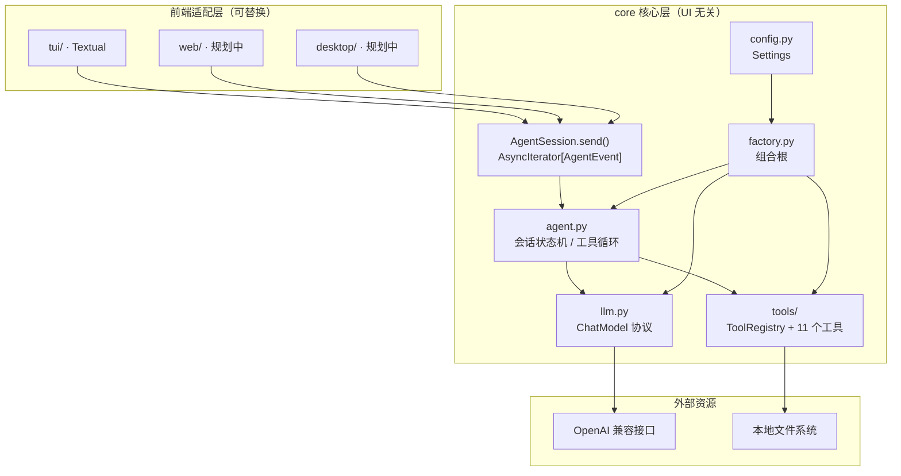

# xagent

基于 `D:\weiLLM\agent\practice02\file_agent.py` 改造的本地文件操作 Agent。

核心目标是把**业务逻辑**与**界面展示**彻底分离：

- `core/`：Agent 编排、LLM 访问、工具注册与执行、配置。完全不依赖任何 UI 框架，也不直接 `print`。
- `tui/`：Textual 终端界面，只消费 `core` 暴露的异步事件流。
- 未来新增 `web/`、`desktop/` 时，复用同一个 `core`，不需要修改 Agent 逻辑。

## 目录结构

```text
xagent/
├── core/                       # 核心层（UI 无关）
│   ├── __init__.py             # 公共 API 出口
│   ├── agent.py                # AgentSession：对话状态机 + 事件流
│   ├── config.py               # Settings / config.ini / 环境变量
│   ├── events.py               # UI 无关的事件模型
│   ├── factory.py              # 组合根：装配模型、工具、会话
│   ├── llm.py                  # ChatModel 协议 + AsyncOpenAI 实现
│   ├── models.py               # 工具调用 / 工具结果等领域对象
│   ├── prompts.py              # 系统提示词
│   └── tools/
│       ├── base.py             # Tool、ToolContext、ToolRegistry
│       ├── filesystem.py       # 10 个文件 / 目录工具
│       ├── helpers.py          # 路径、文本、JSON、安全保护
│       └── system.py           # 时间查询工具
├── tui/                        # Textual 表示层
│   ├── __main__.py             # python -m tui
│   ├── app.py                  # XAgentApp：事件 → 界面
│   ├── commands.py             # 斜杠命令解析
│   ├── styles.tcss             # Textual CSS
│   └── widgets/
│       ├── chat.py             # 消息容器与自动滚动
│       ├── messages.py         # 用户 / 助手 / 工具 / 错误消息
│       ├── prompt.py           # 带历史记录的输入框
│       └── status.py           # 状态栏
├── tests/                      # 无网络回归测试
├── main.py                     # 统一启动入口
├── config.ini                  # 本地配置（已 gitignore）
├── config.ini.example          # 配置模板
├── pyproject.toml
└── requirements.txt
```

## 分层与依赖规则

```text
tui（及未来的 web / desktop）
        │  只依赖 core 公共 API 和事件
        ▼
core/agent.py  ──►  core/llm.py  ──►  OpenAI 兼容接口
        │
        └────────►  core/tools  ──►  本地文件系统

core/factory.py 负责上述依赖的装配；core/config.py 提供配置。
```

必须遵守的约束：

1. `core` 不得导入 `tui`、`textual`、`rich` 或任何界面库。
2. `tui` 不直接访问 OpenAI 客户端、工具实现或文件系统，只通过 `AgentSession` 交互。
3. `core` 通过事件流反馈进度，不直接输出到控制台，方便 Web / Desktop 复用。
4. 工具统一返回 JSON 字符串；异常在 `ToolRegistry` 内被转换为失败结果。
5. 新增前端只依赖 `core` 的公共 API；新增工具只修改 `core/tools`。

## 架构图



### 一次请求的事件流

```text
AgentSession.send(prompt)
  ├─ RunStarted
  ├─ TextDelta*                       # 模型流式文本
  ├─ ToolCallStarted                  # 即将执行工具
  ├─ ToolCallFinished                 # 工具执行结果
  ├─ TextDelta*                       # 模型根据结果继续回答
  └─ RunFinished / RunFailed
```

工具调用会按模型返回顺序执行，结果回填到对话历史后再次请求模型，直到模型不再调用工具。`max_tool_rounds` 防止模型陷入无限工具循环。

## 环境要求

- Python 3.10+
- `openai>=1.30,<4`
- `textual>=0.80,<9`
- `get_date` 在 Windows 上调用系统 `date` / `time` 命令，其他平台回退到 Python 时间

## 安装

```bash
cd agent/xagent
pip install -r requirements.txt
```

也可以安装为命令：

```bash
pip install -e .
xagent
```

## 配置

复制模板并填写密钥：

```bash
copy config.ini.example config.ini
```

```ini
[llm]
base_url = https://api.deepseek.com
model_name = deepseek-chat
api_key = sk-your-key-here

[agent]
max_read_chars = 20000
max_tool_rounds = 16
```

| 配置项 | 说明 |
| --- | --- |
| `base_url` | OpenAI 兼容接口地址 |
| `model_name` | 模型名称 |
| `api_key` | 访问密钥 |
| `max_read_chars` | 单次读取文件返回给模型的最大字符数 |
| `max_tool_rounds` | 单轮用户请求允许的最大工具调用轮数 |

配置查找顺序：`--config` 参数 > `XAGENT_CONFIG` 环境变量 > 项目根目录 `config.ini` > 启动目录 `config.ini`。

单项配置也可用环境变量覆盖，适合 CI / 部署场景：

| 环境变量 | 覆盖项 |
| --- | --- |
| `XAGENT_BASE_URL` | `base_url` |
| `XAGENT_MODEL` | `model_name` |
| `XAGENT_API_KEY` | `api_key` |
| `XAGENT_CONFIG` | 配置文件路径 |

`config.ini` 已加入 `.gitignore`，请勿提交真实密钥。

## 运行

```bash
python main.py
# 或
python -m tui
# 指定配置文件 / 工作目录
python main.py --config .\config.ini --directory D:\weillm\test
```

相对路径以**启动时的工作目录**（或 `--directory` 指定目录）为基准。`get_current_directory` 返回同一个基准目录。

## TUI 使用

启动后进入聊天界面：

```text
请输入指令，Enter 发送；/help 查看命令
```

示例指令：

```text
列出当前目录下的所有文件
读取 README.md 的内容
在 D:\weillm\test 下创建 notes.md，内容写“今日待办”
把 notes.md 里的“今日待办”替换成“今日完成”
把 notes.md 重命名为 todo.md
```

### 快捷键

| 按键 | 功能 |
| --- | --- |
| `Enter` | 发送消息 |
| `↑` / `↓` | 浏览输入历史 |
| `Esc` | 取消当前请求 |
| `Ctrl+N` | 开始新会话 |
| `Ctrl+L` | 清空屏幕 |
| `Ctrl+Q` | 退出 |

### 斜杠命令

| 命令 | 功能 |
| --- | --- |
| `/help` | 显示帮助 |
| `/status` | 查看模型、工作目录、工具和历史消息数 |
| `/new` | 清空对话历史并开始新会话 |
| `/clear` | 清空当前屏幕 |
| `/quit` | 退出 |

## 工具

工具名统一使用 `snake_case`。与 `practice02` 相比，`getDate` 更名为 `get_date`，并改为返回 JSON。

| 工具名 | 参数 | 说明 |
| --- | --- | --- |
| `get_date` | 无 | 获取当前日期时间 |
| `get_current_directory` | 无 | 获取工作目录绝对路径 |
| `list_directory` | `directory="."` | 列出目录内容（类型、大小、修改时间、MIME） |
| `get_file_type` | `path` | 文件类型、扩展名、MIME、是否纯文本 |
| `read_text_file` | `path` | 读取纯文本，最多返回 `max_read_chars` 字符 |
| `create_file` | `directory`、`filename`、`content`、`overwrite` | 创建文件，自动创建目录 |
| `edit_text_file` | `path`、`mode`、`content`、`old_string`、`new_string`、`replace_all` | `replace` / `append` / `overwrite` |
| `create_directory` | `path` | 创建目录，自动创建父目录 |
| `delete_directory` | `path` | 递归删除目录 |
| `delete_file` | `path` | 删除文件 |
| `rename_path` | `source`、`destination`、`overwrite` | 重命名 / 移动文件或目录 |

工具统一返回：

```json
{
  "success": true,
  "path": "D:\\weillm\\test\\notes.md",
  "size": 42
}
```

失败时：

```json
{
  "success": false,
  "error": "文件不存在",
  "path": "D:\\weillm\\test\\missing.md"
}
```

### 新增工具

在 `core/tools/` 中实现处理器并注册即可，`agent.py` 和 `tui` 无需改动：

```python
from core.tools import Tool, ToolContext, ToolRegistry

def hello(context: ToolContext, arguments: dict) -> str:
    return '{"success": true, "message": "hello"}'

registry = ToolRegistry(ToolContext(base_dir=Path.cwd()))
registry.register(
    Tool(
        name="hello",
        description="示例工具",
        parameters={"type": "object", "properties": {}, "required": []},
        handler=hello,
    )
)
```

处理器约定：

- 接收 `ToolContext` 和参数字典；
- 返回 JSON 字符串，且包含 `success`；
- 抛出异常也可以，`ToolRegistry` 会转换为失败 JSON。

## 为 Web / Desktop 复用 core

UI 层与 `core` 的契约只有一个异步事件流：

```python
from core import create_session
from core.events import (
    RunFailed,
    RunFinished,
    TextDelta,
    ToolCallFinished,
    ToolCallStarted,
)

session = create_session()  # 每个客户端 / 会话一个实例

async for event in session.send(user_text):
    if isinstance(event, TextDelta):
        await send_to_frontend({"type": "text", "text": event.text})
    elif isinstance(event, ToolCallStarted):
        await send_to_frontend({"type": "tool_start", "name": event.name})
    elif isinstance(event, ToolCallFinished):
        await send_to_frontend(
            {"type": "tool_end", "ok": event.success, "data": event.payload}
        )
    elif isinstance(event, RunFinished):
        await send_to_frontend({"type": "done", "text": event.content})
    elif isinstance(event, RunFailed):
        await send_to_frontend({"type": "error", "message": event.message})
```

落地建议：

| 前端 | 接入方式 |
| --- | --- |
| Web（FastAPI） | 每个连接创建 `AgentSession`，通过 SSE 或 WebSocket 转发事件；HTTP 请求只负责收发，不保存 UI 状态 |
| Desktop（PySide6 / Electron / PyWebView） | 在后台 asyncio 线程运行事件循环，把事件转换为 Qt Signal / IPC 消息 |
| 其他 CLI | 实现新的 `cli/` 包，按事件打印即可 |
| 测试 | 注入实现 `ChatModel.stream()` 的假模型，无需网络 |

注意：`AgentSession` 持有对话历史，每个用户 / 会话应独立创建，不要跨并发请求共享。

## 安全保护

| 措施 | 说明 |
| --- | --- |
| 高危路径拦截 | 拒绝删除 / 重命名磁盘根目录、工作目录、用户主目录及其上级目录 |
| 默认不覆盖 | `create_file`、`rename_path` 的 `overwrite` 默认 `false` |
| 参数校验 | 缺失必填参数、非 JSON 参数会直接返回失败结果 |
| 异常隔离 | 单个工具异常不会中断会话 |
| 纯文本限制 | 读取 / 编辑前检查扩展名、MIME 和内容 |
| 二进制检测 | 检查前 8192 字节是否含空字节 |
| 只读文件兼容 | Windows 下删除失败时先移除只读属性再重试 |
| 读取上限 | 超出 `max_read_chars` 截断并返回 `truncated: true` |

这些保护用于减少误操作，**不是安全沙箱**。Agent 仍能访问当前用户有权访问的路径。

## 与 practice02 的对应关系

| practice02 | xagent | 说明 |
| --- | --- | --- |
| 单文件 `file_agent.py` | `core/` + `tui/` | 业务与界面分离 |
| 同步 OpenAI 客户端 | `AsyncOpenAI` | 适配 TUI 及未来 Web |
| `print` 输出过程 | `AgentEvent` 事件流 | 前端自行决定如何展示 |
| 内嵌 `TOOL_HANDLERS` | `ToolRegistry` | 注册、校验、异常隔离集中管理 |
| `getDate` 返回纯文本 | `get_date` 返回 JSON | 统一工具返回协议 |
| 读取当前目录 `config.ini` | 项目根 / `--config` / 环境变量 | 部署更可控 |
| 无工具轮数限制 | `max_tool_rounds` | 防止模型死循环 |

## 测试

```bash
python -m unittest discover -s tests -v
```

测试完全离线：使用脚本化 `ChatModel` 覆盖多轮工具调用、非法 JSON、轮数上限、路径保护、文件生命周期，以及 Textual 的无头交互。

## 已知限制

- 仅支持纯文本文件；`.docx`、`.pdf`、`.xlsx` 等二进制格式无法读取。
- 没有沙箱、权限管理或操作审计，不适合多用户生产环境。
- 会话历史保存在内存中，退出即丢失。
- `replace` 是字面量替换，不支持正则。
- `get_date` 的 Windows 命令输出格式随系统区域设置变化。

## 常见问题

**启动提示“配置错误”**
确认 `config.ini` 存在且包含 `[llm]` 段，或使用 `--config` / `XAGENT_CONFIG` 指定路径。

**`ModuleNotFoundError: No module named 'textual'`**
执行 `pip install -r requirements.txt`。

**`Error code: 401` / `402`**
检查 `api_key`；402 表示账户余额不足。

**工具返回“仅支持读取纯文本文件”**
目标文件被判定为二进制格式。

**删除目录时报“拒绝操作当前工作目录本身”**
这是安全保护。请在目标目录的上级目录启动，或改为操作具体子目录。
